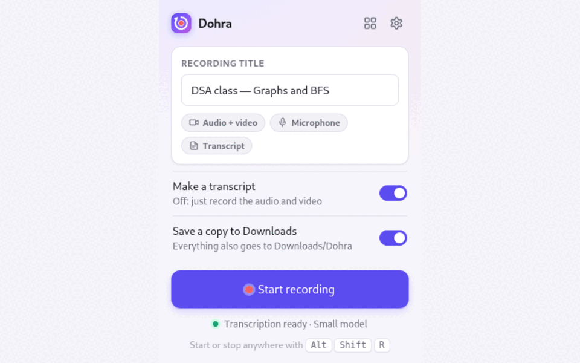
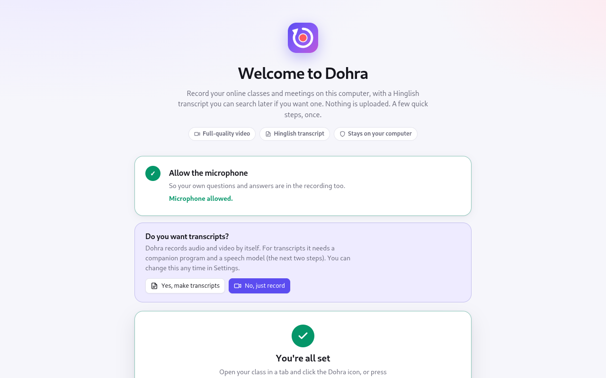
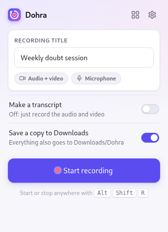
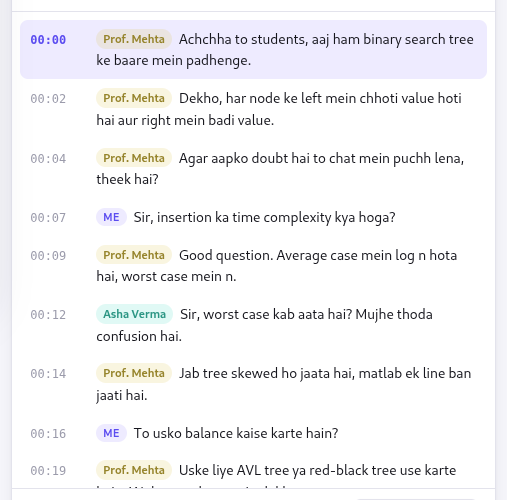
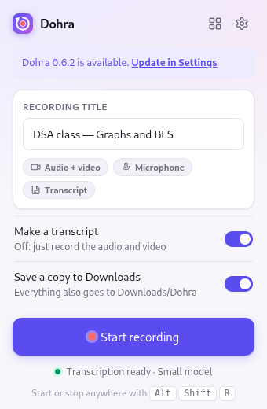
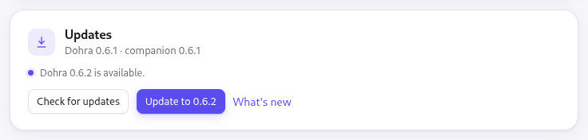

<p align="center">
  
</p>

<h1 align="center">Dohra</h1>

<p align="center">
  <b>Record any online class or meeting in your browser, on your own computer,<br />
  with a searchable Hinglish transcript that knows who said what.</b>
</p>

<p align="center">
  <a href="https://github.com/SHIVAM-SHARMA-766/dohra/releases/latest"></a>
  <a href="https://github.com/SHIVAM-SHARMA-766/dohra/actions/workflows/ci.yml"></a>
  <a href="LICENSE"></a>
  
  
</p>

<p align="center">
  <a href="#install-in-five-minutes"><b>Install</b></a> ·
  <a href="#record-a-class">Record</a> ·
  <a href="#transcripts-in-hinglish">Transcripts</a> ·
  <a href="#who-said-what">Who said what</a> ·
  <a href="#library">Library</a> ·
  <a href="#settings-and-updates">Settings &amp; updates</a> ·
  <a href="#faq">FAQ</a> ·
  <a href="#more-documentation">Docs</a>
</p>

<p align="center">
  
</p>

*Dohra* comes from the Hindi *dohrana*, "to revise". Live classes move faster than
anyone can take notes; Dohra keeps the whole class so you can go back to it.

## Why Dohra

| | |
|---|---|
| 🔒 **Private by design** | Recordings and transcripts are written to your own disk. No server, no account, nothing uploaded. |
| 👻 **No bot in the meeting** | Dohra records what your browser already plays, so nobody sees an extra attendee. |
| 🌐 **Works on any site** | Google Meet, Microsoft Teams, Zoom's web client, YouTube Live, or your course's own player. |
| 🗣️ **Hinglish transcripts** | Hindi in Roman script ("theek hai"), English as English, made on your computer while the class runs. |
| 👥 **Knows who spoke** | In Meet and Teams, each line is labelled with the speaker's name. |
| 🎬 **Or just a recorder** | Turn transcripts off and Dohra is a simple, full-quality video recorder. |
| 🔄 **Updates in one click** | Settings checks for new versions and installs them for you. |
| 💸 **Free and open source** | MIT licensed. Every download is checked against a pinned SHA-256. |

## Install in five minutes

Dohra runs in **Chrome, Edge and Brave** on **Linux, Windows and macOS**. You load it
yourself from the latest release; it takes about five minutes, plus the speech
model's download if you want transcripts.

### Step 1 — Download

Download **[dohra-extension.zip](https://github.com/SHIVAM-SHARMA-766/dohra/releases/latest/download/dohra-extension.zip)**
and unzip it into a folder you will keep, for example `Documents/Dohra`. The browser
loads Dohra from this folder every time it starts, so keep it where it is.

### Step 2 — Load it into the browser

1. Open `chrome://extensions` (`edge://extensions` in Edge, `brave://extensions` in Brave).
2. Turn on **Developer mode** (top right) and leave it on.
3. Click **Load unpacked** and choose the unzipped folder, the one with `manifest.json`.
4. Click the puzzle-piece icon in the toolbar and pin **Dohra**.


### Step 3 — Follow the setup page

Dohra opens a short setup page by itself and ticks off each step as it is done.

**Allow the microphone**, so your own questions are part of the recording.

**Choose: transcripts, or just recording.** Pick **No, just record** and you are done:
Dohra is ready as a video recorder. Pick **Yes, make transcripts** for the two steps
below. You can switch any time in Settings.

<table>
  <tr>
    <td width="50%"></td>
    <td width="50%"></td>
  </tr>
  <tr>
    <td align="center"><sub>With transcripts: install the companion</sub></td>
    <td align="center"><sub>Just recording: done after the microphone</sub></td>
  </tr>
</table>

**Install the companion** (transcripts only). A small program on your computer makes
the transcripts; nothing is uploaded. The setup page shows the commands for your
system with a **Copy** button. Paste them into a terminal (PowerShell on Windows), and
the page notices by itself when the companion is ready.

<details>
<summary><b>🐧 Linux</b> — commands</summary>

```sh
curl -fLo dohra-companion https://github.com/SHIVAM-SHARMA-766/dohra/releases/latest/download/dohra-companion-linux-amd64
chmod +x dohra-companion
./dohra-companion install
```
On ARM, use `dohra-companion-linux-arm64`.
</details>

<details>
<summary><b>🪟 Windows</b> — commands (PowerShell)</summary>

```powershell
Invoke-WebRequest https://github.com/SHIVAM-SHARMA-766/dohra/releases/latest/download/dohra-companion-windows-amd64.exe -OutFile dohra-companion.exe
.\dohra-companion.exe install
```
On ARM, use `dohra-companion-windows-arm64.exe`.
</details>

<details>
<summary><b>🍎 macOS</b> — commands (needs <a href="https://brew.sh">Homebrew</a>)</summary>

```sh
brew install whisper-cpp
curl -fLo dohra-companion https://github.com/SHIVAM-SHARMA-766/dohra/releases/latest/download/dohra-companion-darwin-$(uname -m | sed s/x86_64/amd64/)
chmod +x dohra-companion
./dohra-companion install
```
</details>

<details>
<summary>What does <code>install</code> do?</summary>

It copies the companion into your user folder, downloads whisper.cpp (the speech
engine) and a voice detector, checks every file against a pinned SHA-256, and
registers itself with Chrome, Chromium, Brave and Edge. You can delete the downloaded
`dohra-companion` file afterwards.
</details>

**Choose a speech model** (transcripts only). Click **Download** on one; the first one
downloaded is used straight away. The page recommends one for your computer.


| Model | Download | On a 6-core laptop |
|---|---|---|
| **Small** | 190 MB | Fastest; keeps up with any class |
| **Medium** | 540 MB | Balanced; transcript ready a few minutes after class |
| **High** (Hindi2Hinglish) | 575 MB | Best for Hindi and Hinglish; ready about 15 minutes after an hour-long class |

You can download, switch or remove models later in **Settings**, and an interrupted
download picks up where it stopped.

## Record a class

1. Open the class in a tab.
2. Click the Dohra icon and press **Start recording**. The toolbar icon shows **REC**.
3. **Pause** and **Stop** are in the same popup, or press <kbd>Alt</kbd>+<kbd>Shift</kbd>+<kbd>R</kbd>
   anywhere to start or stop.

<table>
  <tr>
    <td width="33%"></td>
    <td width="33%"></td>
    <td width="33%"></td>
  </tr>
  <tr>
    <td align="center"><sub>Ready to record</sub></td>
    <td align="center"><sub>Recording, transcript keeping up</sub></td>
    <td align="center"><sub>Transcript off: just recording</sub></td>
  </tr>
</table>

Every recording gets the best your screen allows, with nothing to configure:

- 🎥 **Audio and video** at your screen's full resolution (about 1.2 GB per hour at 1080p).
- 🎙️ **Your microphone**, so your questions are in it too.
- 📝 **A transcript**, while **Make a transcript** is on.

You can keep using other tabs while recording, and closing the class's tab stops and
saves the recording.

**Mute follows the meeting.** In Google Meet, Microsoft Teams, Zoom and Webex on the
web, while you are muted in the meeting your microphone is silent in the recording
too. The popup's **Mute** button does the same on any site.

**Crash-safe.** If the browser or the computer stops mid-class, open the library: the
recording is finished automatically, up to the last few seconds.

## Transcripts in Hinglish

The companion writes the transcript while you record, so it is ready soon after
class, and the popup shows how far it has got. Hindi comes out in Roman script and
English stays English, so a class can switch languages freely.

Open a recording to read its transcript beside the video:


- ▶️ **Click any line** to jump the video there; the playing line is highlighted and followed.
- 🔎 **Search** in either script: `padhenge` also finds `पढ़ेंगे`.
- 📄 **Download transcript (.txt)** for plain text with timestamps and names.
- 🧾 **Transcribe this recording** makes a transcript later for anything recorded
  without one.
- 📥 **Import video** in the library brings in a file you already have (MP4, WebM,
  MP3, M4A, WAV) and transcribes it, with a live percentage.

## Who said what

In **Google Meet** and **Microsoft Teams** on the web, Dohra watches the speaking
indicator on each participant's tile and labels every line with the speaker's name,
each person in their own colour. Your own lines are **Me**.

<p align="center">
  
</p>

> 💡 Keep the meeting in a grid or sidebar layout, so everyone's tile is on screen.

## Library

**Library** (the grid icon in the popup) lists every recording with its length, size
and transcript state. Search titles, open, save a copy, delete, or **Import video**.


Every recording is also copied to your **Downloads** folder, one folder per class, so
it survives even removing the browser:

```
Downloads/Dohra/2026-10-06_190000_dsa-class/
  recording.webm    the recording — plays in any browser, VLC or mpv
  session.json      title, source page, start and end time, duration, SHA-256
  transcript.json   timestamped lines with speakers, once transcribed
  speakers.json     who was speaking when, for Meet and Teams
```

## Settings and updates

**Settings** (the gear icon) holds the few things you can change: transcripts on or
off, the speech model, a microphone switch for the popup, the Downloads copy, and
updates.

<table>
  <tr>
    <td width="60%" rowspan="2"></td>
    <td width="40%"></td>
  </tr>
  <tr>
    <td></td>
  </tr>
</table>

**Updating is one click.** Dohra checks for a new version once a day and the popup
tells you when there is one. In **Settings → Updates**, press **Update to …**: the
companion downloads the release from GitHub, verifies every file against its SHA-256,
installs it into your Dohra folder, updates itself, and Dohra restarts with your
recordings untouched.

<details>
<summary>Updating without the companion</summary>

Download the new
[dohra-extension.zip](https://github.com/SHIVAM-SHARMA-766/dohra/releases/latest/download/dohra-extension.zip),
unzip it over the same folder, and press the reload icon on Dohra's card in
`chrome://extensions`.
</details>

## FAQ

<details>
<summary><b>Is anything uploaded anywhere?</b></summary>

No. Recordings, transcripts and speech models all live on your computer. Dohra only
goes online to download the companion, the speech models and updates from GitHub.
</details>

<details>
<summary><b>Will the teacher or other participants know?</b></summary>

No bot joins and nothing changes in the meeting. Your browser shows its own
"this tab is being shared" indicator to you while recording.
</details>

<details>
<summary><b>Do I need the companion?</b></summary>

Only for transcripts and one-click updates. As a plain recorder, the extension is all
you need: choose **No, just record** during setup or switch transcripts off in the popup.
</details>

<details>
<summary><b>Which speech model should I pick?</b></summary>

Take the one the setup page recommends. Pick **High** if your classes are mostly in
Hindi or Hinglish and you can wait a little longer after class; pick **Small** for the
quickest results on a modest laptop. You can switch at any time.
</details>

<details>
<summary><b>Do I need headphones?</b></summary>

They help: without them, your microphone also hears the class from your speakers.
</details>

<details>
<summary><b>How do I uninstall?</b></summary>

Remove Dohra in `chrome://extensions`, then run the companion's uninstall:

- Linux: `~/.local/share/dohra/bin/dohra-companion uninstall --purge`
- macOS: `~/Library/Application\ Support/Dohra/bin/dohra-companion uninstall --purge`
- Windows: `& "$env:LOCALAPPDATA\Dohra\bin\dohra-companion.exe" uninstall --purge`

Your copies in `Downloads/Dohra/` stay.
</details>

## More documentation

| Document | What's in it |
|---|---|
| [docs/ROADMAP.md](docs/ROADMAP.md) | What is being built next |
| [docs/KNOWN-ISSUES.md](docs/KNOWN-ISSUES.md) | Known limitations and their workarounds |
| [ARCHITECTURE.md](ARCHITECTURE.md) | How the extension and the companion work inside |

Found a problem or have an idea? [Open an issue](https://github.com/SHIVAM-SHARMA-766/dohra/issues).

## Develop

Build from source (Node.js 20.19+, and Go 1.26 for the companion):

```sh
git clone https://github.com/SHIVAM-SHARMA-766/dohra && cd dohra
npm ci && npm run build      # then Load unpacked the dist/ folder
cd companion && go build -o dohra-companion . && ./dohra-companion install
```

<details>
<summary>Scripts and tests</summary>

```sh
npm run watch        # rebuild dist/ on change; reload the extension to pick it up
npm run typecheck
npm test             # unit tests (vitest)
npm run e2e          # end-to-end test in real Chromium; Linux, needs xvfb-run and Go
npm run e2e:update   # updating from Settings, against a local stand-in for GitHub
npm run package      # release/dohra-extension.zip
xvfb-run -a node scripts/screenshots.mjs   # docs/images/, after an e2e run

cd companion && go test ./...   # the companion
```

A build loaded from a checkout updates with `git pull && npm run build`, then a reload
in `chrome://extensions`.
</details>

<details>
<summary>Releasing</summary>

Bump `version` in `package.json`, commit, then push a matching tag:

```sh
git tag v0.6.1 && git push origin v0.6.1
```

The release workflow builds the extension zip and the companion for Linux, Windows and
macOS, and attaches them to a GitHub release with their checksums. Installed copies
offer the update within a day.
</details>

## License

Dohra is released under the [MIT License](LICENSE).

It downloads, and does not include, software and models under their own licenses:
[whisper.cpp](https://github.com/ggml-org/whisper.cpp) (MIT), OpenAI's Whisper
models (MIT), the [Silero VAD](https://github.com/snakers4/silero-vad) model (MIT), and
[Oriserve/Whisper-Hindi2Hinglish-Apex](https://huggingface.co/Oriserve/Whisper-Hindi2Hinglish-Apex)
(Apache 2.0), converted for whisper.cpp in
[dohra-models](https://github.com/SHIVAM-SHARMA-766/dohra-models).
