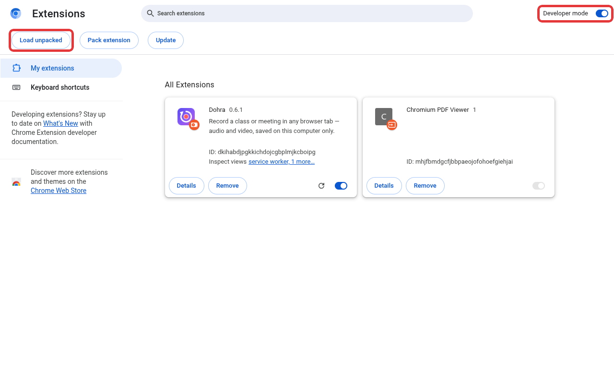
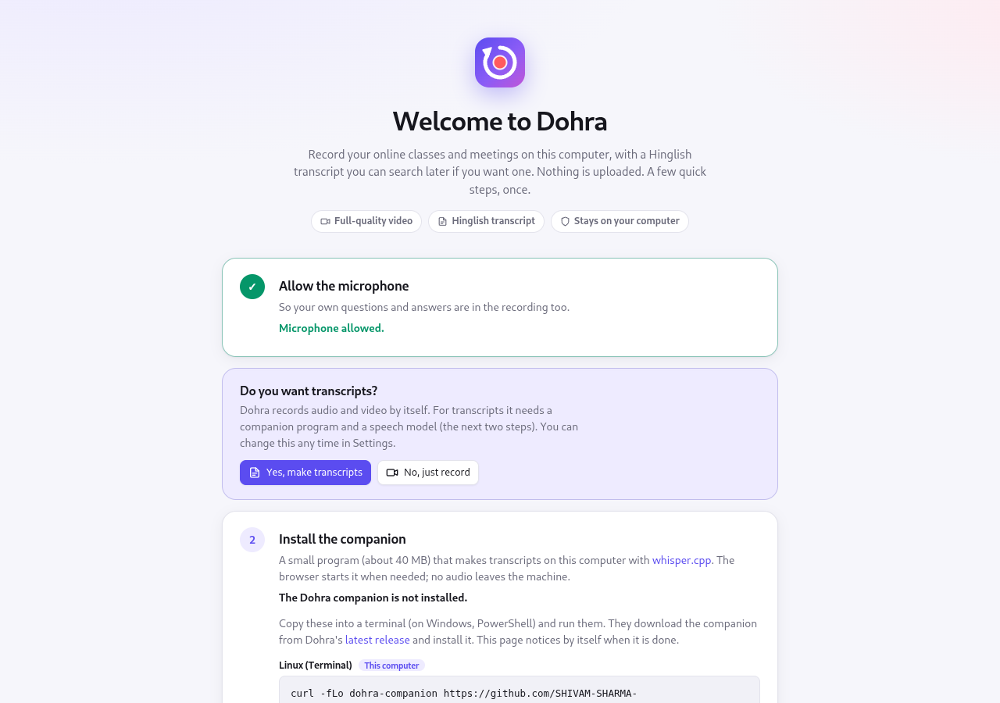
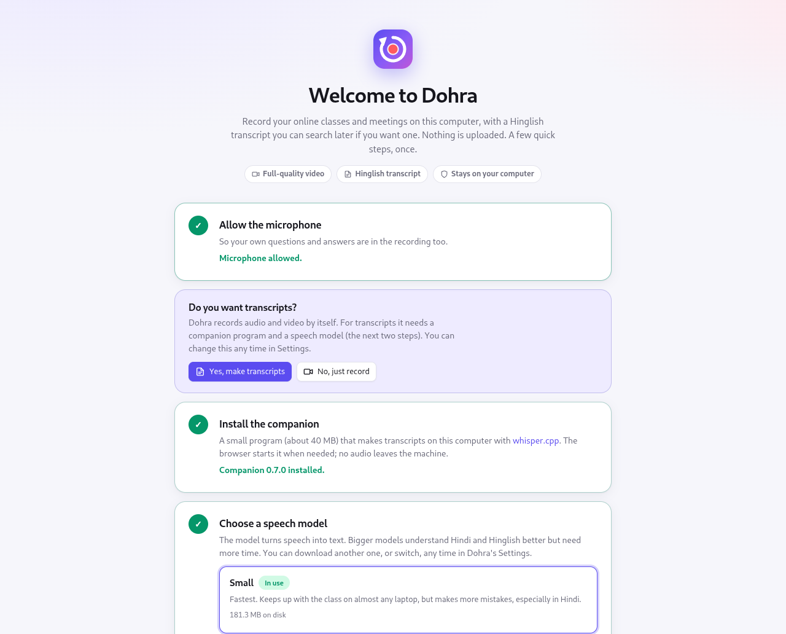
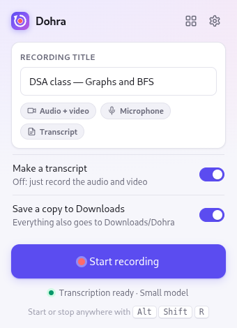
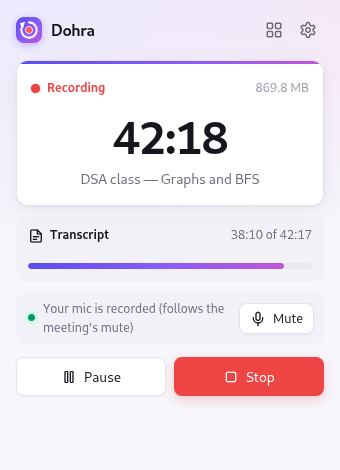
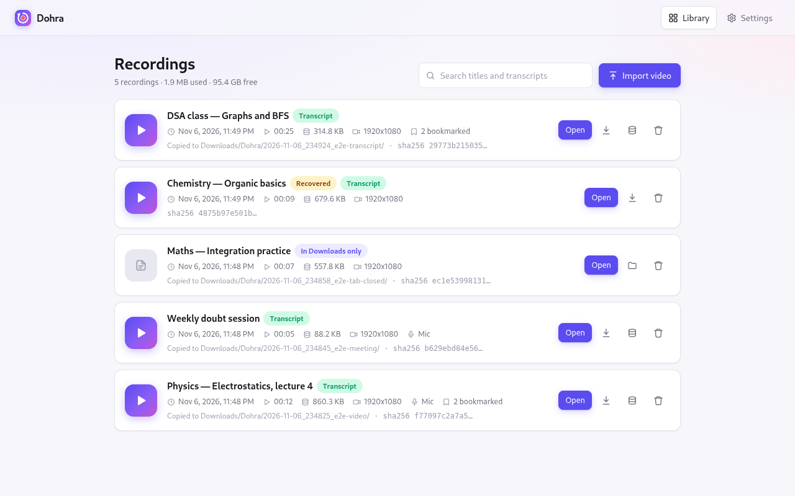
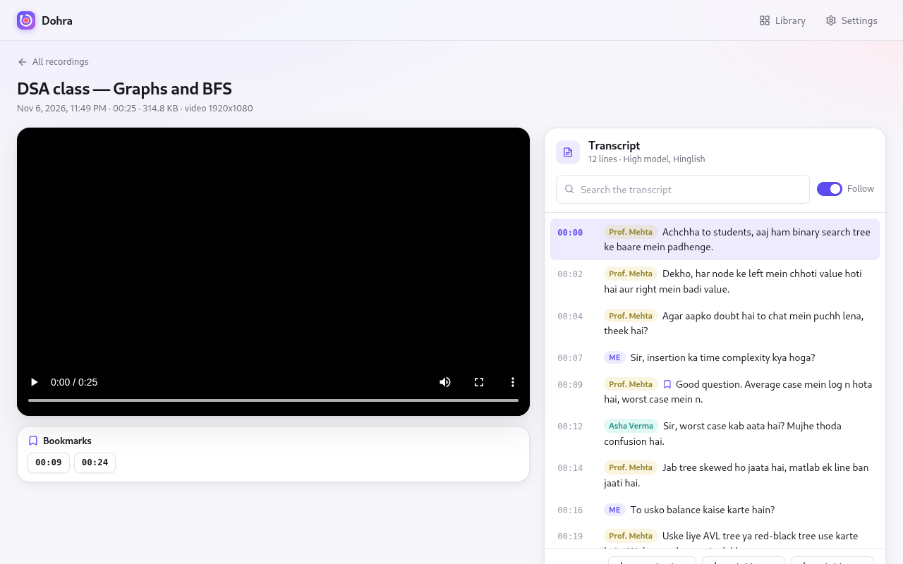
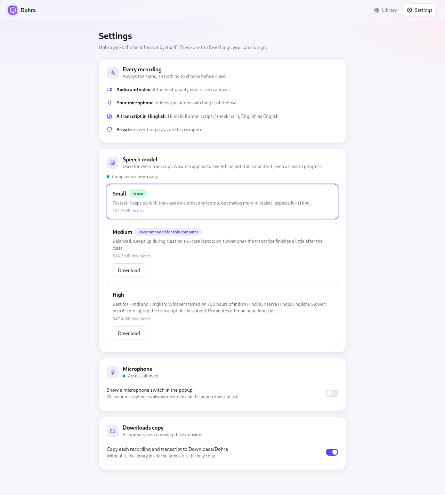

# Dohra

Record a class or meeting playing in a browser tab, with its audio and video, and
keep the recording on your own computer.

*Dohra* comes from the Hindi *dohrana*, "to revise". The tool exists because live
classes move faster than notes can be taken. Without a recording, there is nothing to
revise from afterwards.

- **No bot joins the meeting.** Dohra records what your browser is already playing, so
  other participants see no extra attendee.
- **Nothing leaves the machine.** Recordings are written to local disk. There is no
  server and no account.
- **Works with any site.** Google Meet, Zoom's web client, Teams on the web, YouTube
  Live, or a course's own player all work, because Dohra captures the tab and not a
  particular platform.
- **Transcripts are optional.** With them on, you get a searchable Hinglish transcript
  that names who spoke in Meet and Teams. With them off, Dohra is a plain video
  recorder and needs nothing besides the extension.

## Status

**Stages 1 and 2 — recording and transcripts — are done.** Later stages build on the
same session format:

| Stage | What | Status |
|---|---|---|
| 1 | Record a tab's audio and video locally, browse and play recordings | Done |
| 2 | Transcript made on this computer while the class runs (Hindi, English, Hinglish), "me / them" labels or the speaker's name from Meet and Teams, written as Roman-script Hinglish | Done |
| 3 | Plain-English meaning of each line, unfinished sentences completed, summary | Planned |
| 4 | Live transcript in a side panel, with a hotkey to hide it while screen sharing | Planned |
| 5 | Desktop apps (e.g. the Zoom app) as well as browser tabs | Planned |

## Install, step by step

Dohra runs in Chromium-based browsers (**Chrome, Edge and Brave**) on Linux, Windows or
macOS. It is not on the Chrome Web Store yet, so you load it yourself. That takes about
five minutes, plus the speech model's download.

### 1. Download the extension

Download **[dohra-extension.zip](https://github.com/SHIVAM-SHARMA-766/dohra/releases/latest/download/dohra-extension.zip)**
from the [latest release](https://github.com/SHIVAM-SHARMA-766/dohra/releases/latest)
and unzip it into a folder you will keep, for example `Documents/Dohra`. The browser
loads Dohra from that folder every time it starts, so do not delete or move it.

### 2. Load it into the browser

1. Open `chrome://extensions` (`edge://extensions` in Edge, `brave://extensions` in
   Brave).
2. Turn on **Developer mode**, at the top right.
3. Click **Load unpacked** and choose the unzipped folder: the one that contains
   `manifest.json`.



4. Click the puzzle-piece icon in the toolbar and pin **Dohra**, so it is one click
   away.

### 3. Follow the setup page

Dohra opens its setup page by itself. Each step is ticked off as it is done.

**Allow the microphone**, so your own questions are recorded too.

**Do you want transcripts?** Choose **No, just record** to use Dohra as a plain
recorder: you are done, and the two steps below disappear. Choose **Yes** (the default)
for transcripts, which need the companion and a speech model. You can change your mind
later in **Settings → Transcripts**.

**Install the companion.** Transcripts are made by a small program on your computer.
Nothing is uploaded. The page shows the commands for your system, with a **Copy**
button. Open a terminal (on Windows, *PowerShell*), paste the commands and press
Enter. The page notices by itself when the companion is installed.



| System | Commands |
|---|---|
| Linux | `curl -fLo dohra-companion https://github.com/SHIVAM-SHARMA-766/dohra/releases/latest/download/dohra-companion-linux-amd64`<br>`chmod +x dohra-companion`<br>`./dohra-companion install` |
| Windows (PowerShell) | `Invoke-WebRequest https://github.com/SHIVAM-SHARMA-766/dohra/releases/latest/download/dohra-companion-windows-amd64.exe -OutFile dohra-companion.exe`<br>`.\dohra-companion.exe install` |
| macOS (needs [Homebrew](https://brew.sh)) | `brew install whisper-cpp`<br>`curl -fLo dohra-companion https://github.com/SHIVAM-SHARMA-766/dohra/releases/latest/download/dohra-companion-darwin-$(uname -m \| sed s/x86_64/amd64/)`<br>`chmod +x dohra-companion`<br>`./dohra-companion install` |

`install` copies the companion into your user folder, downloads whisper.cpp (the speech
engine) and a voice detector, checks every file against a pinned SHA-256, and registers
itself with Chrome, Chromium, Brave and Edge. The downloaded `dohra-companion` file
can be deleted afterwards. ARM builds are in the release as well
(`dohra-companion-linux-arm64`, `-windows-arm64.exe`).

**Choose a speech model.** Click **Download** on one. The first one downloaded is used
straight away.



| Model | Download | On a 6-core laptop |
|---|---|---|
| **Small** | 190 MB | Keeps up with any class; more mistakes, especially in Hindi |
| **Medium** | 540 MB | Keeps up; the transcript is ready a few minutes after class |
| **High** (Hindi2Hinglish) | 575 MB | Clearly best for Hindi and Hinglish; ready about 15 minutes after an hour-long class |

The page recommends Medium for computers with 8 or more CPU threads, and Small
otherwise. You can download another model, switch, or remove one later in **Settings
→ Speech model**. An interrupted download continues where it stopped.

## Record a class

1. Open the class in a tab.
2. Click the Dohra icon and press **Start recording**. The toolbar icon shows **REC**
   while recording.
3. **Pause** and **Stop** are in the same popup. `Alt+Shift+R` starts or stops
   recording without opening it.

| Before | While recording |
|---|---|
|  |  |

While recording, the popup shows how far the transcript has got. It also shows whether
your microphone is being recorded, with a **Mute** button.

Every recording is the same, so there is nothing to choose:

- **audio and video**, at your screen's full resolution — about 1.2 GB per hour at
  1920×1080;
- **your microphone**;
- **a transcript**, if **Make a transcript** is on (the default), written as Hinglish:
  Hindi in Roman script ("theek hai"), English as English. Turn the switch off in the
  popup to just record.

The popup shows exactly what will be recorded before you start.
Closing the tab also stops the recording and saves it. You can keep using other tabs
while recording.

**Your microphone** is part of every recording. The first time, the popup asks you to
allow microphone access, and **Start** stays disabled until you do. To be able to leave
the microphone out of some recordings, turn on *Show a microphone switch in the
quick-start popup* on Dohra's **Settings** page (linked from the popup and the
library). The popup then shows **Include my microphone**. Use headphones if you can;
otherwise the microphone also picks up the class from your speakers.

**Muting.** In Google Meet, Microsoft Teams, Zoom and Webex on the web, Dohra follows
the meeting's mute: while you are muted there, your microphone is silent in the
recording and the transcript too. On any site, **Mute** in the popup (while recording)
does the same, whatever the meeting says.

**Transcripts** are made while you record, by the companion, in Roman-script
Hinglish, so a class can move freely between Hindi and English.

**Who said what.** In Google Meet and Microsoft Teams on the web, Dohra also notes
who is speaking, from the speaking indicator on each person's tile, and puts that
name on the transcript's lines instead of **Them**. It only knows people whose tile is
on screen, so keep the meeting in a grid or sidebar layout rather than one full-screen
presentation. Lines where nobody visible was speaking stay **Them**.
The popup shows how far the transcript has got. If the companion is not installed or
not ready, the class is still recorded, and the popup says the transcript will be
missing; it can be made later from the recording's page.

**Import video** in the library adds a file you already have, such as a class
downloaded earlier or an old Dohra recording, in any format the browser plays (MP4,
WebM, MP3, M4A, WAV). It is copied into Dohra and transcribed straight away. Keep
its page open until the audio has been sent; after that the companion carries on
by itself.

While a transcript is being made, the recording's page shows a percentage and a
progress bar, and lines appear as each part (about two minutes of audio) finishes.
The library shows the same percentage.

## Library and transcripts

**Library** (the grid icon in the popup) lists every recording, with its transcript's
state. **Import video** adds a file you already have.



Open a recording to see it with its transcript:



- Click any line to jump the recording to that moment; the line being played is
  highlighted and kept in view (untick **Follow** to scroll freely).
- **Search** finds a word in either script — `padhenge` finds `पढ़ेंगे`.
- Transcripts made before 0.4 are in Devanagari; for those, switch between
  **देवनागरी** and **Roman** (a mechanical transliteration).
- Lines are marked **Me** (your microphone), the speaker's name (in Meet and Teams),
  or **Them** (the tab, when the speaker is not known).
- **Download transcript (.txt)** saves it as plain text with timestamps.

A recording made while the companion was missing can be transcribed afterwards from
its page with **Transcribe this recording**.

**Settings** (the gear icon) holds the few things you can change: transcripts on or
off, the speech model, a microphone switch for the popup, and the Downloads copy. It
also checks for and installs updates (see [Update or uninstall](#update-or-uninstall)).



### Where recordings go

- **The library.** Click **Library** in the popup to list, search, open, save, or
  delete recordings. They are stored inside the browser profile.
- **Downloads/Dohra/.** Each finished recording is also copied to your Downloads folder,
  one folder per session:

  ```
  Downloads/Dohra/2026-10-06_190000_dsa-class/
    recording.webm   the recording (WebM; plays in any browser, VLC, mpv)
    session.json     title, source page, start/end time, duration, SHA-256 of the file
    transcript.json  timestamped lines with speaker, once transcribed
  ```

  This copy survives removing the extension or the browser. You can turn it off in the
  popup or in Settings. Turning it off saves disk space, but the browser's copy is then the only one.

**If the browser crashes** mid-recording, open the library afterwards. It finishes the
interrupted recording automatically and keeps everything up to the last few seconds.

### Update or uninstall

- **Update from Settings (0.6 and later, with the companion):** Dohra checks for a new
  release once a day; the popup says when there is one. In **Settings → Updates**,
  press **Check for updates**, then **Update to …**. The companion downloads the new
  release from GitHub, checks every file against the release's SHA-256 sums, writes
  the new extension into the folder you loaded Dohra from, updates itself, and Dohra
  restarts on its own. Recordings are kept. Updating waits until a recording is
  finished. Keep **Developer mode** on in `chrome://extensions`: Chrome disables an
  unpacked extension that restarts without it.
- **Update by hand** (without the companion, or from a version before 0.6): download
  the new
  [dohra-extension.zip](https://github.com/SHIVAM-SHARMA-766/dohra/releases/latest/download/dohra-extension.zip),
  unzip it over the same folder, and press the reload icon on Dohra's card in
  `chrome://extensions`. To update the companion, run the commands from step 3 again.
- **Uninstall:** remove Dohra in `chrome://extensions`, then run
  `~/.local/share/dohra/bin/dohra-companion uninstall --purge` (Linux),
  `~/Library/Application\ Support/Dohra/bin/dohra-companion uninstall --purge` (macOS) or
  `& "$env:LOCALAPPDATA\Dohra\bin\dohra-companion.exe" uninstall --purge` (Windows).
  Removing the extension deletes the library inside the browser; the copies in
  `Downloads/Dohra/` stay.

### Limits worth knowing

- **Tested on Linux.** The extension is the same everywhere, but the companion has so
  far run only on Linux. Windows and macOS builds are published and should work;
  please [open an issue](https://github.com/SHIVAM-SHARMA-766/dohra/issues) if they
  don't.
- **Browser tabs only.** Classes in a desktop app, such as the Zoom app, are not
  captured yet; open them in the browser instead.
- **Browser pages are off limits.** Pages such as `chrome://` and the Web Store cannot
  be recorded.
- **The recording indicator stays visible.** The browser always shows its own "this tab
  is being shared" indicator, and Dohra cannot hide it.
- **Check your course's terms.** Some course platforms forbid recording in their terms
  of use, so check before relying on Dohra for one.
- **Updating from Settings finds Dohra through the browser's profile.** It works for
  Chrome, Chromium, Brave and Edge in their usual places. A browser installed as a
  Snap or Flatpak, or a folder under a development checkout, is updated by hand.
- **Speaker names depend on the meeting's page.** They are read from Meet's and
  Teams' web pages, which change without notice; if names stop appearing after such a
  change, the lines simply say **Them** again. They have not yet been checked in a
  large real meeting; please report what you see. Zoom and Webex lines stay **Them**.
- **Transcripts are only as good as the model.** Expect misheard names and terms,
  especially with the small model and in Hindi. The recording is always there to check
  against: click the line.
- **Upgrading from 0.1.** Remove Dohra in `chrome://extensions` and load it again with
  **Load unpacked**; reloading is not enough. Since 0.2 the extension's ID is fixed so
  the companion can trust it, and an installed 0.1 keeps its old ID until removed. The
  library then starts empty; recordings made with 0.1 remain in `Downloads/Dohra/`.

## Develop

Build from source (needs Node.js 20.19 or later, and Go 1.26 for the companion):

```sh
git clone https://github.com/SHIVAM-SHARMA-766/dohra && cd dohra
npm ci && npm run build      # then Load unpacked the dist/ folder
cd companion && go build -o dohra-companion . && ./dohra-companion install
```

```sh
npm run watch       # rebuild dist/ on change; reload the extension to pick it up
npm run typecheck
npm test            # unit tests (vitest)
npm run e2e         # end-to-end test in real Chromium; Linux, needs xvfb-run and Go
npm run package     # release/dohra-extension.zip
xvfb-run -a node scripts/screenshots.mjs   # docs/images/, after an e2e run

cd companion && go test ./...   # the companion
```

How the pieces fit together is in [ARCHITECTURE.md](ARCHITECTURE.md).

**Releasing:** bump `version` in `package.json`, commit, then push a matching tag:

```sh
git tag v0.5.0 && git push origin v0.5.0
```

The release workflow builds the extension zip and the companion for Linux, Windows and
macOS, and attaches them to a GitHub release with their checksums.

## License

Dohra is released under the [MIT License](LICENSE).

It downloads, and does not include, software and models under their own licenses:
- [whisper.cpp](https://github.com/ggml-org/whisper.cpp) (MIT);
- OpenAI's Whisper models (MIT);
- the [Silero VAD](https://github.com/snakers4/silero-vad) model (MIT);
- [Oriserve/Whisper-Hindi2Hinglish-Apex](https://huggingface.co/Oriserve/Whisper-Hindi2Hinglish-Apex)
  (Apache 2.0), converted for whisper.cpp in
  [dohra-models](https://github.com/SHIVAM-SHARMA-766/dohra-models).
