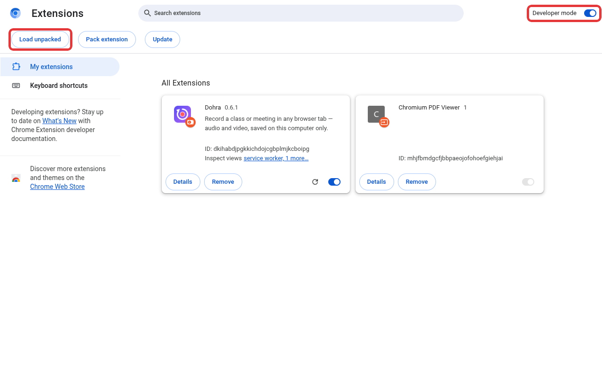
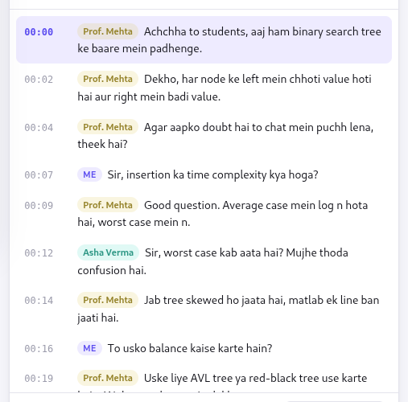
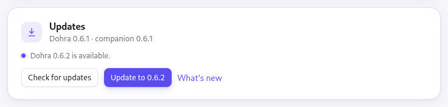

# Known issues

Limitations of the current version of Dohra, what to do about each, and where a fix
is planned. What is being built next is in [ROADMAP.md](ROADMAP.md). Something not
listed here? [Open an issue](https://github.com/SHIVAM-SHARMA-766/dohra/issues).

| Area | Issue | Workaround | Fix planned |
|---|---|---|---|
| Install | [Developer mode must stay on](#developer-mode-must-stay-on) | Leave it on | — (browser rule) |
| Install | [Companion tested on Linux only](#companion-tested-on-linux-only) | Report problems on Windows or macOS | [Roadmap #2](ROADMAP.md#2-windows-and-macos-in-ci) |
| Recording | [Browser tabs only](#browser-tabs-only) | Join the class in the browser | [Roadmap #12](ROADMAP.md#12-stage-5-desktop-apps) |
| Recording | [Browser pages cannot be recorded](#browser-pages-cannot-be-recorded) | — | — (browser rule) |
| Recording | ["This tab is being shared" stays visible](#the-sharing-indicator-stays-visible) | — | — (browser rule) |
| Recording | [Two copies of every recording](#two-copies-of-every-recording) | Turn off the Downloads copy, or delete old recordings | [Roadmap #8](ROADMAP.md#8-disk-space) |
| Recording | [Duration after the laptop sleeps](#duration-after-the-laptop-sleeps) | None needed; the file plays | — |
| Transcripts | [Speaker names need the tiles on screen](#speaker-names-need-the-tiles-on-screen) | Grid or sidebar layout | [Roadmap #1](ROADMAP.md#1-verify-speaker-names-in-real-meetings) |
| Transcripts | [Echo without headphones](#echo-without-headphones) | Use headphones | [Roadmap #7](ROADMAP.md#7-echo-without-headphones) |
| Transcripts | [Misheard words](#misheard-words) | Use a bigger model; click the line to check | — |
| Transcripts | [Long recordings transcribed afterwards](#long-recordings-transcribed-afterwards) | Keep other tabs light while it runs | [Roadmap #6](ROADMAP.md#6-long-recordings) |
| Transcripts | [Small and Medium spell Hinglish loosely](#small-and-medium-spell-hinglish-loosely) | Use High | — |
| Updates | [One-click update needs the companion and a usual browser install](#one-click-update-needs-the-companion) | Update by hand | — |
| Updates | [First update to 0.6 is by hand](#first-update-to-06-is-by-hand) | Update once by hand | — (one time) |
| Other | [Chromium browsers only](#chromium-browsers-only) | Use Chrome, Edge or Brave | — |
| Other | [Course terms of use](#course-terms-of-use) | Check before recording | — |

---

## Install

### Developer mode must stay on

Dohra is loaded with **Load unpacked**, which needs **Developer mode** in
`chrome://extensions`. Chrome checks it again whenever an extension restarts, for
example after an update: with Developer mode off, it disables Dohra. Leave the
switch on.

### Companion tested on Linux only

The extension is the same everywhere, and the companion is built for Windows and
macOS in every release, but so far it has only been run on Linux. If installing or
transcribing fails on Windows or macOS, please open an issue with the setup page's
message.

## Recording

### Browser tabs only

Dohra captures a browser tab. A class in a desktop app, such as the Zoom app, is not
captured; most meeting services also run in the browser, so join from there.

### Browser pages cannot be recorded

Pages such as `chrome://` and the Chrome Web Store cannot be captured by any extension.

### The sharing indicator stays visible

While recording, the browser shows its own "this tab is being shared" indicator. It
is shown only to you, and no extension can hide it.

### Two copies of every recording

Each recording is kept in the browser's library and copied to `Downloads/Dohra/`,
about 1.2 GB per hour at 1080p each. Turn off **Copy each recording and transcript to
Downloads/Dohra** in Settings to keep one, or delete recordings you no longer need
from the library.

### Duration after the laptop sleeps

If the computer sleeps during a recording, the length shown in the library may differ
slightly from the video's. The recording itself plays normally.

## Transcripts

### Speaker names need the tiles on screen

Names are read from the participant tiles Meet and Teams show. Someone speaking while
their tile is hidden — many participants with only a few tiles visible, or one
full-screen presentation — is labelled **Them**, and when two people talk at once the
line goes to whoever spoke longer. Meet and Teams also change their pages from time
to time; if names stop appearing, lines fall back to **Them** until Dohra is updated.
Zoom and Webex lines are always **Them**.

Keep the meeting in a grid or sidebar layout so the speakers' tiles stay on screen.

### Echo without headphones

Without headphones, your microphone also picks up the class from your speakers, and
some of the meeting's lines appear a second time as **Me**. Echo cancellation reduces
this but does not remove it. Headphones avoid it.

### Misheard words

Transcripts are only as good as the speech model: expect misheard names and technical
terms, more with Small and in fast Hindi. The recording is always there: click a line
to hear it. **High** is the most accurate for Hindi and Hinglish.

### Long recordings transcribed afterwards

**Transcribe this recording** and **Import video** load the whole file's audio into
memory first. A recording of several hours can make the page slow or run out of memory
on a computer with little RAM. Live transcription during a recording is not affected.

### Small and Medium spell Hinglish loosely

Small and Medium are steered into Roman-script Hinglish rather than trained for it,
so spelling varies ("padhenge" / "parhenge") and a long English stretch may drift.
High is trained for Hinglish. Transcripts made by early versions are in Devanagari;
the recording's page can show them in Roman script.

## Updates

### One-click update needs the companion

**Update to …** in Settings uses the companion to rewrite Dohra's folder. It finds
the folder through the profiles of Chrome, Chromium, Brave and Edge installed in their
usual places. Without the companion, with a browser installed as a Snap or Flatpak,
or for a copy built from source, Settings says an update is available and Dohra is
updated by hand: download the new
[dohra-extension.zip](https://github.com/SHIVAM-SHARMA-766/dohra/releases/latest/download/dohra-extension.zip),
unzip it over the same folder, and reload Dohra in `chrome://extensions`.

Without the companion, the check itself uses GitHub's public API, which allows 60
requests an hour per network address; on a busy shared network it may fail until
later.

### First update to 0.6 is by hand

One-click updates arrived in 0.6. Copies older than that update once by hand (above),
and run the companion's install commands again; after that, Settings does it.

Copies from 0.1 must be removed in `chrome://extensions` and loaded again with **Load
unpacked**, since 0.2 fixed the extension's ID. The library then starts empty;
recordings made with 0.1 remain in `Downloads/Dohra/`.

## Other

### Chromium browsers only

Dohra needs the browser's tab-capture support for extensions, which Firefox does not
offer. It works in Chrome, Edge and Brave.

### Course terms of use

Some course platforms forbid recording in their terms of use. Check before relying on
Dohra for one.
