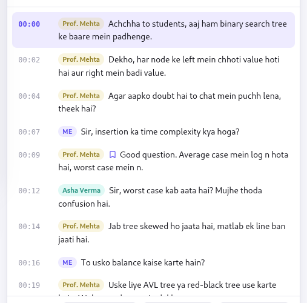
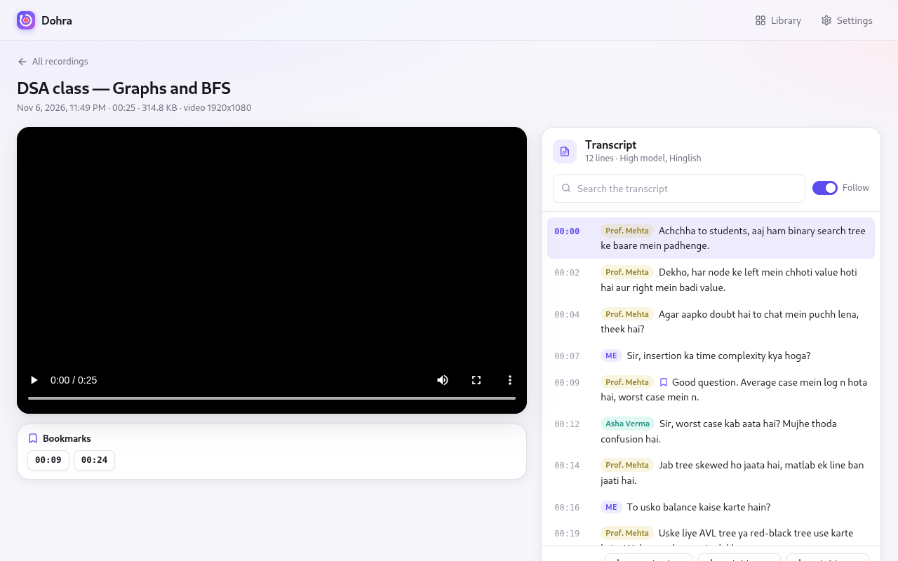
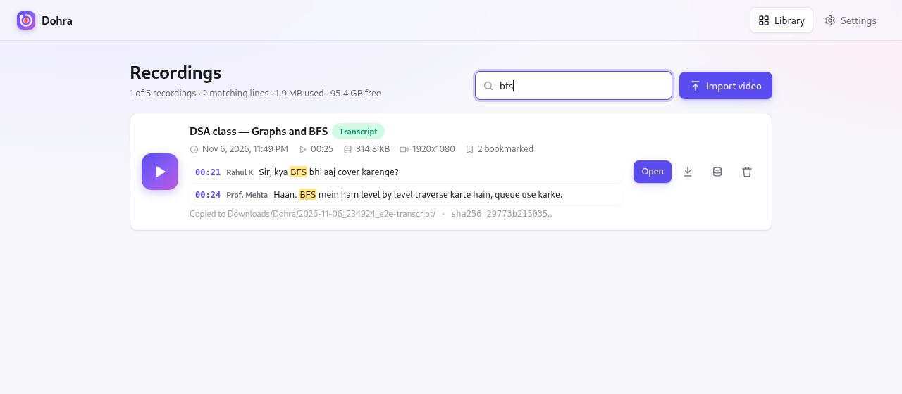
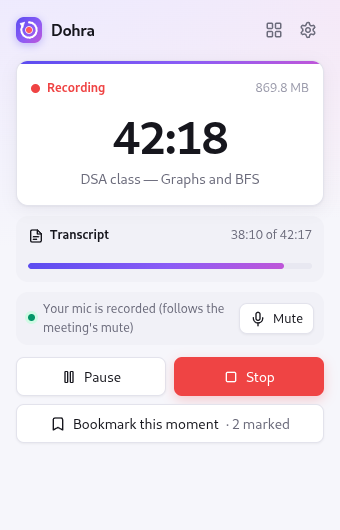

# Roadmap

What is being built next for Dohra, in order of priority. Each item says why it
matters and where it will show up in the app. Known limitations of the current
version, with workarounds, are in [KNOWN-ISSUES.md](KNOWN-ISSUES.md).

Status: ✅ done · 🔨 in progress · ⏭️ next · 🗓️ later

| # | Item | Area | Status |
|---|---|---|---|
| 1 | [Verify speaker names in real Meet and Teams meetings](#1-verify-speaker-names-in-real-meetings) | Transcripts | 🔨 |
| 2 | [Test the companion on Windows and macOS in CI](#2-windows-and-macos-in-ci) | Reliability | 🔨 |
| 3 | [Subtitles export (.srt and .vtt)](#3-subtitles-export) | Transcripts | ✅ 0.7 |
| 4 | [Search inside every transcript from the library](#4-search-every-transcript) | Library | ✅ 0.7 |
| 5 | [Bookmark a moment while recording](#5-bookmarks-while-recording) | Recording | ✅ 0.7 |
| 6 | [Transcribe long recordings without loading them whole](#6-long-recordings) | Transcripts | ⏭️ |
| 7 | [Drop echoed lines when recording without headphones](#7-echo-without-headphones) | Transcripts | ✅ 0.7 |
| 8 | [Disk space warnings and a single-copy option](#8-disk-space) | Storage | ✅ 0.7 |
| 9 | [Signed releases](#9-signed-releases) | Security | ✅ 0.7 |
| 10 | [Stage 3: summary, key points and plain-English meaning](#10-stage-3-summary-and-meaning) | Revision | 🗓️ |
| 11 | [Stage 4: live transcript in a side panel](#11-stage-4-live-side-panel) | Recording | 🗓️ |
| 12 | [Stage 5: desktop apps such as the Zoom app](#12-stage-5-desktop-apps) | Recording | 🗓️ |

## Done

| Version | What |
|---|---|
| 0.7 | Subtitles (.srt, .vtt); search inside every transcript from the library; bookmarks while recording; echoed lines dropped without headphones; low-disk warning and keeping videos only in Downloads; signed releases |
| 0.6 | Speaker names from Meet and Teams; transcripts optional (plain recorder mode); one-click updates from Settings |
| 0.5 | Roman-script Hinglish transcripts; High model (Hindi2Hinglish); Import video; live transcription progress; following the meeting's mute; new design |
| 0.4 | Speech models (Small, Medium, High) chosen and downloaded in the app; first-run setup page |
| 0.3 | One fixed format: full-resolution video, microphone and transcript for every recording |
| 0.2 | Transcripts made on this computer by the companion (whisper.cpp) |
| 0.1 | Recording a tab's audio and video to local disk; library; crash recovery |

---

## 1. Verify speaker names in real meetings

Speaker names come from the speaking indicator on each participant's tile in Meet and
Teams. They pass the automated test against a page built like Meet's, but have not
yet been checked in a large real meeting, where layouts, presentations and many
participants vary.

**Plan:** record real Meet and Teams calls of different sizes and layouts, compare the
names in the transcript with who actually spoke, and tune tile detection from the
`speakers.json` each recording saves. Add a "names not detected" hint in the
recording's page when the meeting could not be read.

## 2. Windows and macOS in CI

The extension is the same on every system, but the companion has so far run only on
Linux. The release already builds it for Windows and macOS.

**Plan:** run the companion's tests, an install, and a transcription of a short sample
on `windows-latest` and `macos-latest` runners (free for public repositories), and
cover the Windows update path, where the running `.exe` is renamed aside before the
new one is moved in.

## 3. Subtitles export

✅ **Done in 0.7.** **Subtitles .srt** and **.vtt** next to *Download .txt* on the
recording's page play the transcript as captions in VLC, mpv or any video player,
with speakers' names (in front of the text in SRT, as WebVTT voice tags in VTT).

## 4. Search every transcript

The library searches titles today; each recording's page searches its own transcript.

✅ **Done in 0.7.** The library's search looks inside every transcript too (in either
script, and by speaker), lists the matching lines under each recording, and opens the
video at that line.

## 5. Bookmarks while recording

✅ **Done in 0.7.** <kbd>Alt</kbd>+<kbd>Shift</kbd>+<kbd>B</kbd> or **Bookmark this
moment** in the popup marks the current moment. Bookmarks appear under the video and
beside the transcript line, and the library shows how many a recording has.

## 6. Long recordings

Making a transcript afterwards, for an imported or older recording, currently decodes
the whole file's audio in memory at once.

**Plan:** decode and send the audio in pieces (WebCodecs), so a two- or three-hour
recording transcribes as smoothly as a short one.

## 7. Echo without headphones

Without headphones, the microphone also hears the class from the speakers, and the
same words can appear twice: once from the meeting and once as **Me**.

✅ **Done in 0.7.** A microphone line is left out of the transcript when it overlaps a
meeting line in time and most of its words are in it. Your own questions, which share
few words with what the teacher is saying, are kept.

## 8. Disk space

Each recording is kept in the browser and copied to Downloads, about 1.2 GB per hour
at 1080p, twice.

✅ **Done in 0.7.** The popup warns when the disk has room for less than two hours of
recording, and the library shows the free space. **Free up space** on a recording, or
turning off *Also keep each video in the browser* in Settings, keeps the video only in
Downloads once that copy is verified; the transcript, bookmarks and search stay.

## 9. Signed releases

Updates are checked against the release's SHA-256 sums, which catch damaged
downloads.

✅ **Done in 0.7.** Every release's `SHA256SUMS` is signed with the maintainer's
Ed25519 key, on the maintainer's computer, and the companion installs an update only
when the signature matches the public key built into it.

## 10. Stage 3: summary and meaning

The original goal of Dohra is revision.

**Plan:** after class, a local language model run by the companion (llama.cpp, free
and offline) writes a summary, key points, and questions to revise, and gives a
plain-English meaning for each line, completing half-spoken sentences. Nothing leaves
the computer.

## 11. Stage 4: live side panel

**Plan:** the transcript appears live in the browser's side panel during class, with
a hotkey to hide it instantly while sharing your screen.

## 12. Stage 5: desktop apps

**Plan:** a desktop recorder for classes held in apps such as the Zoom app, writing the
same session folders, so recordings from both appear in the same library.

---

Have an idea or need one of these sooner?
[Open an issue](https://github.com/SHIVAM-SHARMA-766/dohra/issues).
